# Prisma by Purrline Rocketworks  

A two-stage small satellite launcher for [Kitten Space Agency](https://ahwoo.com/app/100000/kitten-space-agency), from the fictional rocket maker Purrline Rocketworks. Inspired by Spectrum from Isar Aerospace.

Validated against KSA build version 2026.11.10.5801.

*The launch video, made in the game with these mods.*

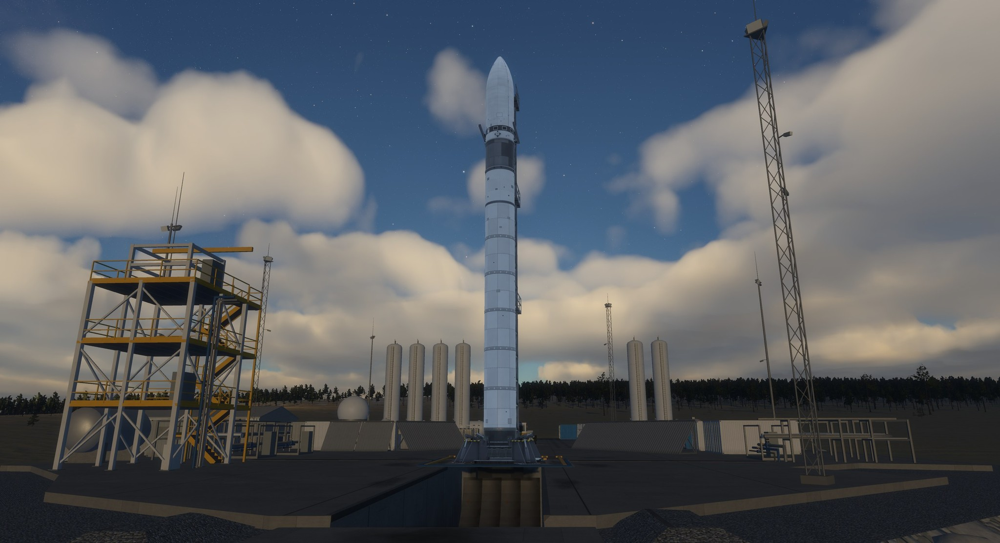

## Parts

| Picture | Part | What it is |
| --- | --- | --- |
| 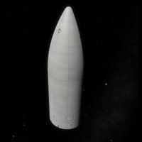 | **Prisma Fairing Half** | Fairing half; place two |
| 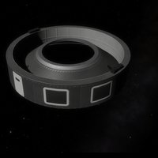 | **Prisma Fairing Base** | Fairing base ring with the 1 m payload adapter |
| 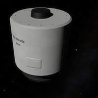 | **Prisma Payload Mass Simulator (1 t)** | 1000 kg dummy payload for test flights |
| 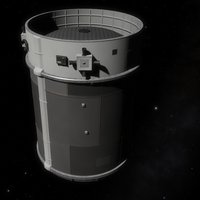 | **Prisma Stage 2** | Upper stage: tank, Altair Vac and four RCS blocks |
| 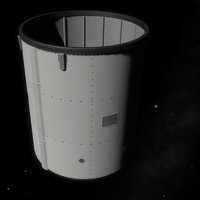 | **Prisma Interstage** | Interstage with its own decoupler; the Altair Vac sits inside |
| 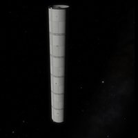 | **Prisma Stage 1 Tank** | The 2 m first stage tank |
| 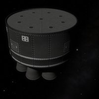 | **Altair Engine Bay** | Nine Altair engines, each with its own gimbal |
| 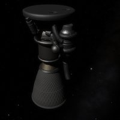 | **Altair** | Single sea level engine |
| 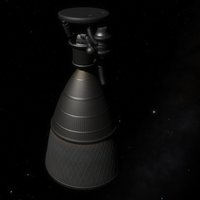 | **Altair Vac** | Single vacuum engine with the long nozzle |
| 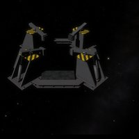 | **Prisma Hold-down Ring** | Holds the rocket on the pad and releases at lift-off |
| 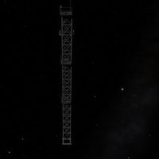 | **Prisma Strongback** | Tower beside the rocket; stays on the pad |

All parts on one sheet: [images/parts/all-parts.jpg](images/parts/all-parts.jpg)

The rocket is about 28 m tall. Sizes and texture density follow the stock parts, so Prisma mixes with stock tanks and engines. The engines burn liquid oxygen and propane.

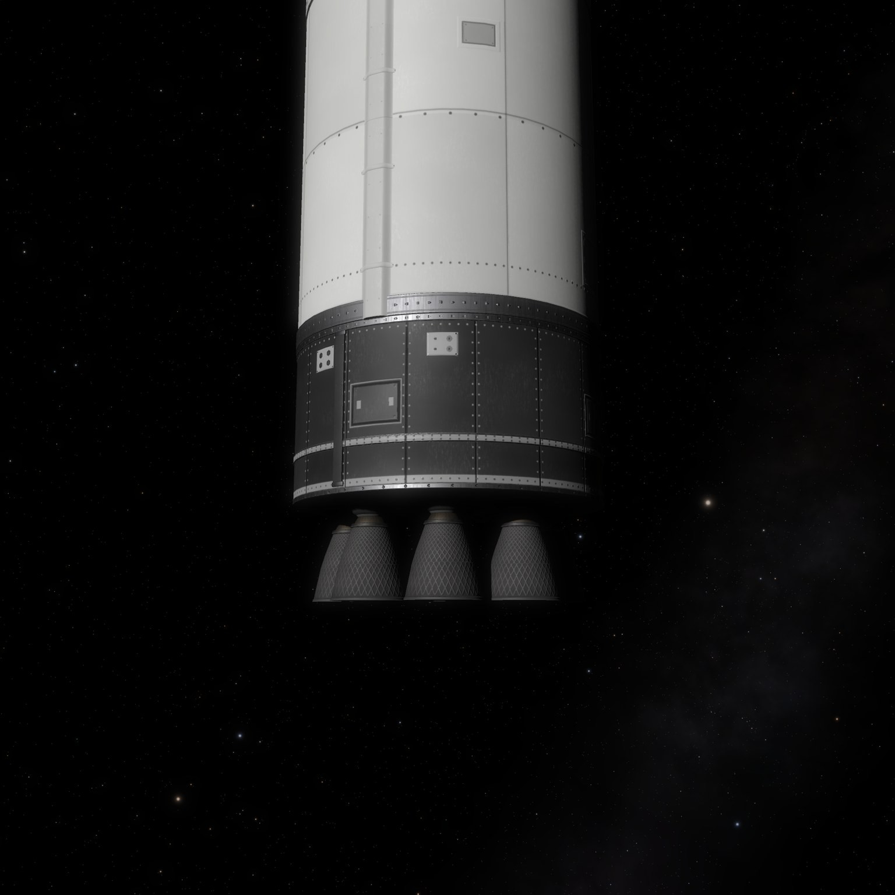

## Install

Requires [Extended Propellants](https://github.com/Maximilian-Nesslauer/KSA-ExtendedPropellants). Without it the engines do not load.

- Borea: install Prisma from the content list. Borea adds Extended Propellants.
- By hand: copy `PurrlinePrisma` and `ExtendedPropellants` from the release zips into `Documents/My Games/Kitten Space Agency/mods/` and enable both.

To remove the mod, delete its folder. Vehicles with its parts do not load without it.

Works well with [Andoya Spaceport](https://github.com/Maximilian-Nesslauer/KSA-AndoyaSpaceport) (a pad for Prisma) and [Facet](https://github.com/Maximilian-Nesslauer/KSA-PurrlineFacet) (satellites for the fairing).

## Licence

Code and game data: MIT ([LICENSE](LICENSE)). Meshes, textures, logo and pictures: CC BY 4.0 ([LICENSE-ART](LICENSE-ART)). Credits: [NOTICE.md](NOTICE.md).

## Links

[Forum thread](https://forums.ahwoo.com/threads/prisma-by-purrline-rocketworks.ID/) | [Issues](https://github.com/Maximilian-Nesslauer/KSA-PurrlinePrisma/issues)
